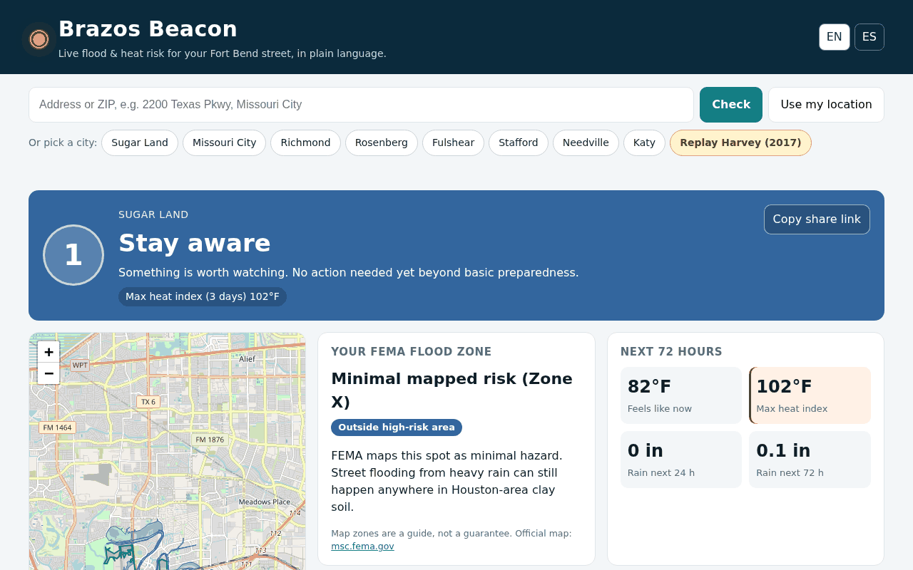

# 🟡 Brazos Beacon

**Live demo:** https://aariv.me/Brazos-beacon/ · **Harvey replay:** https://aariv.me/Brazos-beacon/?demo=harvey

**Live flood & heat risk for your Fort Bend County street, in plain language, in English and Spanish.**



*Screenshot of the live site (Oct 2026), taken with headless Chromium.*

Built for **WarriorHacks 2.0** (Hackathon track): *"Create a project that solves an issue in your community, county, state, or nation."*

---

## Judge it in 60 seconds
1. Open https://aariv.me/Brazos-beacon/ and enter any Fort Bend County address or ZIP.
2. Open https://aariv.me/Brazos-beacon/?demo=harvey for the Hurricane Harvey replay.
3. Toggle English/Español; every string has a Spanish twin.
4. Run `node logic.test.js` (37 unit tests) and the headless-Chromium suites in `tests/` (listed under Testing; all passing when re-run Oct 11, 2026). GitHub Actions runs the unit tests and every stubbed browser suite on each push.

Honest limits: live data comes from public NOAA/NWS/FEMA services and can lag, rate-limit or fail (the page then says *"Could not check everything"*); the browser suites run in headless Chromium only, not on real phones or Safari.

---

## The problem

Fort Bend County sits where the Brazos River, the San Bernard River, and Houston-area bayous meet. During Hurricane Harvey the Brazos at Richmond crested at **55.19 ft** on Sept 1, 2017 (flood stage is 45 ft), the highest since 1915. The county ordered mandatory evacuations for neighborhoods and levee districts along the river, and its emergency office later estimated about **200,000 residents were impacted**. Summer heat is the other everyday danger.

The information people need is public, but it is spread across agencies, apps, and formats:

| Question a resident has | Where the answer lives today |
|---|---|
| "Is the river near me rising?" | NOAA's National Water Prediction Service hydrographs |
| "Is there a warning for my street?" | National Weather Service alerts |
| "Am I in a flood zone?" | FEMA's National Flood Hazard Layer (a GIS map) |
| "How hot will it actually feel?" | NWS forecast grids |
| "What should I do *right now*?" | County preparedness pages |

Brazos Beacon combines all five for one address into **a single 0–4 risk level, a reason for it, and a short checklist**, in English or Spanish. Nobody has to read a hydrograph to use it.

## Features

- **Address → answer.** Type an address or ZIP, tap "Use my location", pick a city chip (Sugar Land, Missouri City, Richmond, Rosenberg, Fulshear, Stafford, Needville, Katy), or click the map.
- **One Beacon level (0–4):** *All clear · Stay aware · Get ready · Take action · Danger*, with the specific drivers listed ("River: Brazos River at Richmond (Major flooding)", "Max heat index (3 days) 109°F").
- **Never a false "All clear".** If NWS alerts, NOAA gauges, or the NWS forecast don't answer, the page says *"Could not check everything"* instead of showing green, and names the missing source.
- **FEMA flood zone at your exact point**, explained in plain words, with your zone's polygon and nearby high-risk areas drawn on the map, plus a link to the official FEMA map for that spot.
- **Nearest 4 river gauges** (distance in miles): current stage, **how many feet below or above flood stage**, the **crest of the official NWS forecast** (not just its next point), when it was observed, and a warning if the reading is more than 6 hours old. Gauges farther than about 9 miles get the same flood-stage distance and forecast high, but are marked *"too far to change your level"* and never raise it.
- **SVG hydrograph:** 7 days observed plus the NWS forecast, with action / minor / moderate / major flood lines.
- **Active NWS watches and warnings** for that exact point, with "until" times.
- **Next 72 hours:** "feels like" now, max heat index, and forecast rain totals for 24 h and 72 h.
- **A personalized action checklist** that changes with the level and your zone (flood insurance's 30-day waiting period if you're in a high-risk zone, "Turn Around, Don't Drown", heat safety, evacuation readiness).
- **Works when the signal drops:** it can be installed to a phone's home screen, and a service worker keeps the app itself (page, scripts, map library) available offline. Each successful check is saved in your browser; if you open it later with no connection and no agency answers, it shows that last check for the same spot, with a clear "Offline: last saw here on … (2 h ago)" note, instead of a blank screen. It never uses a saved check from more than 1.5 km away or older than 72 hours, and live agency data is never served from the cache.
- **Fort Bend resources:** FBC Alert sign-up (text `FBCAlert` to `888777`), Ready Fort Bend, county Homeland Security & Emergency Management (281-342-6185, non-emergency), FEMA Map Service Center, Texas 2-1-1.
- **English and Spanish**, auto-detected from the browser, switchable anytime (NWS alert text itself stays in English, and the app says so).
- **Printable family flood plan.** One tap builds a one-page, fridge-ready plan for that exact spot (English or Spanish): the FEMA zone and what it means, the Beacon level when printed, the nearest NOAA river gauge with its action / flood / moderate / major stages, a "when to do what" ladder for levels 2-4, a Ready.gov go-bag checklist, Fort Bend key numbers, and a QR code back to the live page. The family fills in who lives there, an out-of-area contact, two meeting places, where they would evacuate, medicines and pets (or leaves blanks to write by hand). Those answers are kept only in the browser's localStorage and are never sent anywhere. Print it or save it as a PDF.
- **Shareable links** (`?lat=…&lon=…&lang=es`) so a parent can text the exact view to family. Refreshes every 15 minutes while open.
- **"Replay Harvey" mode with a time slider.** It loads the **real USGS gage record** for the Brazos at Richmond (Aug 24 – Sep 8, 2017) at a point inside the FEMA floodplain. Drag the slider or press **Play the flood** and watch the level climb from *All clear* (Aug 26) to *Danger* as the forecast crest approaches, then fall again. The app only uses readings up to the chosen moment; what the river actually did over the next 48 h stands in for the forecast. The flood warning shown is a clearly labeled re-created example, not an archived NWS product. A **lead-time box** in the replay states the backtest result: using only readings up to each moment (no look-ahead), the level reached *Danger* at 9 PM CDT on Aug 28, 2017, **75 hours (3.1 days) before the 55.19 ft crest**. With the 48-hour outlook it would be 123 hours (5.1 days), and the box says plainly that this second number is hindsight, because the 2017 NWS forecasts are not archived in the app. Readings are every 3 hours, so times are within 3 hours. "Jump to that moment" moves the slider there.
- **"How it works · tested" panel** at the bottom of the page: the never-a-false-all-clear rule, why the level is rules-based (published NWS/FEMA thresholds) instead of AI-generated, the unit-test count, and the data sources.

## Tech (how it works)

```
 address ──► Esri World Geocoder (fallback: OpenStreetMap Nominatim)
                │ lat/lon
   ┌────────────┼──────────────┬──────────────────────┬──────────────────────┐
   ▼            ▼              ▼                      ▼                      ▼
 FEMA NFHL   NOAA NWPS       NWS /alerts/active   NWS /points → gridData   (map: Leaflet + OSM)
 flood zone  gauges in bbox  for the point        heat index + QPF rain
 polygon     → nearest 4 →
             gauge detail +
             stageflow series
   └────────────┴──────────────┴──────────────────────┴──────────────────────┘
                              ▼
                logic.js  (pure functions, unit-tested)
     riverCategory · floodZoneInfo · alertLevel · heatIndexF · rainInches
     overallRisk → level 0-4 + drivers  ·  buildChecklist
                              ▼
                     render (EN / ES strings in i18n.js)
```

- **100% static.** HTML, CSS, and vanilla JS on GitHub Pages: no server, no build step, no API keys, no tracking.
- Every source is a **free, public, CORS-enabled** government or open API.
- Each source loads independently (`Promise.all` over "settled" wrappers with timeouts), so if one agency is down the rest of the page still works and says which source is unavailable.
- **Risk logic is honest about distance:** only gauges within 15 km (about 9 miles) can raise your level, and if FEMA maps you *outside* the 1% and 0.2% floodplains, river stage counts one category lower. (If FEMA's service is down, nothing is discounted.) Farther gauges among the nearest 4 are still listed with their flood-stage distance and forecast high, labeled "too far to change your level". A flood at a gauge across the county shouldn't make your phone scream.
- **Heat uses NWS Houston's own thresholds** ([criteria](https://www.weather.gov/hgx/WWA_criteria)): a forecast heat index of 90°F+ is *Stay aware*, 108°F+ (Heat Advisory criterion) is *Get ready*, 113°F+ (Extreme Heat Warning criterion) is *Take action*. Official heat alerts count at full weight.
- The heat index comes from NWS's grid; if that field is missing, we compute it hour by hour with the **NWS Rothfusz regression** (including both NWS adjustment terms), sampling temperature and humidity at each hour because NWS grid intervals don't line up between fields.
- Many Houston gauges report water-surface *elevation* (e.g. 85 ft at Barker Reservoir), so the app shows **feet to flood stage** rather than a misleading percentage.

### Data sources

| Data | API |
|---|---|
| River gauges, flood categories, forecasts | NOAA National Water Prediction Service: `api.water.noaa.gov/nwps/v1` |
| Watches and warnings | National Weather Service: `api.weather.gov/alerts/active?point=` |
| Heat index, rain (QPF) | NWS gridpoints: `api.weather.gov/points → forecastGridData` |
| Flood zones | FEMA NFHL ArcGIS REST, layer 28 (Flood Hazard Zones) |
| Geocoding | Esri World Geocoder `findAddressCandidates`, OpenStreetMap Nominatim |
| Harvey replay | USGS NWIS instantaneous values, site 08114000 (sampled every 3 h, plus the crest reading) |
| Map tiles | OpenStreetMap |

## Run it locally

```bash
git clone https://github.com/draarivpatel-ui/Brazos-beacon.git
cd Brazos-beacon
python3 -m http.server 8000      # then open http://localhost:8000
node logic.test.js               # 37 unit tests for the risk logic
pip install playwright && python3 -m playwright install chromium
python3 tests/dom_search_map_test.py   # or any other tests/*.py (see Testing)
```

## Project structure

```
index.html      layout + accessibility landmarks
style.css       responsive, mobile-first styles, colour-coded levels
app.js          data loading, rendering, map, SVG hydrograph, share links
logic.js        pure risk logic (runs in browser and Node)
logic.test.js   unit tests (node logic.test.js)
i18n.js         English + Spanish strings
demo.js         real USGS Harvey 2017 series for the replay mode
vendor/qrcode.js  QR code generator for the printable plan (qrcode-generator 1.4.4, MIT, Kazuhiko Arase)
vendor/leaflet.css  Leaflet 1.9.4 stylesheet, self-hosted unchanged (BSD-2-Clause); leaflet.js still loads from unpkg with SRI
og-image.png    link-preview image
```

## Accessibility

Skip link, ARIA live regions for the level and status messages, `aria-pressed` toggles, visible focus rings, a labelled replay slider with spoken time values, a text summary on the hydrograph for screen readers, `prefers-reduced-motion` support, and colour plus text labels so levels are never conveyed by colour alone. Text and badge colours were checked against WCAG AA (4.5:1). The Spanish UI covers the county's large Spanish-speaking population.

Audited Oct 10, 2026 with **axe-core** (WCAG 2.0/2.1/2.2 A and AA plus best practices) in headless Chromium at 1280 px and 390 px, English and Spanish, on the live view, the Harvey replay and the open plan dialog: **0 violations** in all 12 runs. Keyboard-only checks: every control is reachable by Tab with a visible two-tone focus ring; starting the replay moves focus to Play; Space/Enter play and pause; the slider moves 3 hours per arrow key and Home/End jump to the ends; the plan dialog traps focus, Escape closes it and focus returns to the button. Lighthouse mobile on the live site (re-run Oct 11, 2026, after self-hosting the Leaflet stylesheet): Accessibility 100, Best practices 100, SEO 100, Performance 89-100 across runs (first paint about 0.9 s); layout shift on load dropped from 0.49 to 0.01 on phones by shipping the English text in the HTML and reserving space in the level card. Scripts are deferred and the QR library loads only when the plan opens.

Spanish flood terms follow the agencies' own Spanish: NWS *vigilancia* / *aviso* (watch / warning), *nivel de inundación* (flood stage), *inundación menor / moderada / mayor*, *marejada ciclónica*, *índice de calor* ([NWS English-Spanish dictionary](https://www.weather.gov/mfl/EngSpaDict)); the NWS slogan *¡Dé la vuelta, no se ahogue!* ([weather.gov](https://www.weather.gov/fsd/espanol)); FEMA *Área Especial de Riesgo de Inundación (SFHA)* ([FEMA](https://www.fema.gov/es/flood-maps), [FloodSmart](https://www.floodsmart.gov/es/glosario)) and *cauce mayor reglamentario* for the regulatory floodway ([FEMA](https://www.fema.gov/es/about/organization/region-2/floodplain-management-training)); go-bag items worded as on [Listo.gov](https://www.listo.gov/es/kit), Ready.gov's Spanish site.

## Testing

- `node logic.test.js`: **37 unit tests, all passing** (re-run Oct 11, 2026) (flood categories incl. missing/-9999 values, feet-to-flood-stage, what each gauge card may say (feet to flood stage, "no flood stage set" only when NWS truly has none, "flood stage not loaded" when it could not be fetched), forecast crest, distance and floodplain discounting, heat index and NWS Houston thresholds, misaligned NWS grid intervals, rain prorating, "never a false all-clear", Harvey replay never peeking into the future, the replay's lead-time numbers (with and without look-ahead), checklist escalation, the family plan choosing the nearest in-range gauge that has an official flood stage, and the offline fallback only reusing a saved check for the same spot (within 1.5 km) from the last 72 hours). The test file also checks that the test count shown in the app's "How it works" panel matches.
- `python3 tests/plan_print_test.py` (22 checks): the printable family flood plan saved as a US Letter PDF in headless Chromium (APIs stubbed), English and Spanish, blank and with every answer at its maximum length: always exactly one page, QR code drawn, title / level / key numbers / go-bag list printed, every answer printed in full, no app screen behind it. It caught (and Oct 11 fixed) the Spanish sheet spilling onto a 2nd page even when blank; the sheet now steps down to a tighter type size only when it would not fit.
- `python3 tests/live_regression.py` (58 checks; add `--live` to test https://aariv.me/Brazos-beacon/ itself): headless Chromium against the **real** NOAA/NWS/FEMA services (no stubs) at 390 and 1280 px in English and Spanish: the live Sugar Land check shows a real level or the honest "?", lists gauges, and has no page errors, console errors, horizontal overflow or serious/critical axe-core issues; the Harvey replay opens, reads Danger (4) at the 2017 crest, renders the lead-time box, is calmer at the start, and keeps WCAG AA text contrast on every hero colour it passes through. Re-run Oct 11, 2026: 58/58 local and live. It caught (and Oct 11 fixed) the place name on the green All-clear banner at 4.39:1 contrast.
- `python3 tests/readme_tour.py` (50 checks; `--live` for aariv.me): walks the *Judge it in 60 seconds* steps above at 390 px, starting in English and in Spanish, with real data: a Fort Bend ZIP (77469) moves the hero to Richmond with a level in the right language and gauges listed; `?demo=harvey` opens the replay at Danger (4) with the lead-time box; the EN/ES buttons switch `<html lang>`, `aria-pressed`, the tagline and the level name without leaving the replay; no page or console errors, no overflow, no serious/critical axe issues. Re-run live Oct 11, 2026 (~9:05 PM ET): 50/50.
- `python3 tests/dom_wait_test.py` (8 checks, APIs stubbed, English and Spanish): with the NOAA gauge list held back, the hero says which agencies it is still waiting on ("Still waiting on NOAA river gauges."), drops the ones that answered, then shows the normal answer.
- `python3 tests/dom_cls_test.py` (8 checks, APIs stubbed, CPU slowed 4x): the page doesn't jump when the 'Checking live sources' hero is replaced by the answer; layout shift (CLS) stays under 0.1 at 1280 and 390 px, English and Spanish (it was 0.11 at 1280 px before Oct 11).
- `python3 tests/devpost_claims.py` (39 checks; add `--live` for aariv.me; real NOAA/NWS/FEMA data, run by hand): each sentence of the submitted Devpost page that describes the app, checked on the page itself (EN 1280 px, ES 390 px), from the FEMA zone polygon to the Harvey lead-time numbers.
- `python3 tests/dom_search_map_test.py` (29 checks, APIs stubbed, 390 px, English and Spanish): when both address services are rate-limited or unreachable the page says it *could not reach the address search* (or that you seem to be offline) instead of blaming your address, a real no-match still says *could not find that address*, a slow search that answers after you already tapped a city chip can't overwrite that newer pick, a blank search explains itself, *Use my location* gives a different message for permission denied, position unavailable and timed out (and a late answer can't overwrite a newer pick), with JavaScript off the page shows an English + Spanish pointer to weather.gov/hgx and FBC Alert instead of an endless "Loading", map markers aren't unnamed Tab stops, the zoom buttons follow the page language, and the search placeholder fits the field at 390 px. Added Oct 11, 2026 after a strict-judge pass found all of these.
- `python3 tests/dom_replay_test.py` (5 checks): the Harvey replay slider's spoken readout follows the language while the replay is on and is gone when it is off.
- `python3 tests/dom_429_test.py` (18 checks) and `python3 tests/dom_far_gauge_test.py` (17 checks): headless Chromium with every API stubbed. The first checks that a rate limit (HTTP 429) from any source gives the honest "Could not check everything" state, never a false all-clear. The second checks that every listed gauge, including ones farther than 9 miles, shows feet below/above flood stage and the NWS 7-day forecast high in English and Spanish, that a far gauge whose flood stage can't be loaded says "flood stage not loaded", and that far gauges' flood stages are cached for 7 days so refreshes stay within NOAA's 10-requests-per-5-minutes limit.
- During development the app was also run headless (jsdom and Chromium) against the live APIs, with every API failing, with only NWS alerts failing, fully offline (service worker serving the app, the saved last check at the same spot, no saved check used for a different spot), through the Harvey replay at several moments, in Spanish, and at phone width (390 px). The deployed site at aariv.me was checked the same way (1280 px and 390 px, no console errors or failed API requests from the real domain).

## What's next

- Push alerts (Web Push / PWA) when *your* saved spot's level goes up, not the whole county's (needs a small server, which this no-backend project avoids for now).
- Show the inundation map NOAA publishes for forecast flood stages.
- Add Harris County Flood Control District gauges and TxDOT road closures (DriveTexas).
- Vietnamese, Chinese, Hindi and Urdu strings (all widely spoken in Fort Bend).

## Limits and honesty

- **Not an official warning system.** Brazos Beacon is a student project that summarizes public data. Always follow the National Weather Service and Fort Bend County officials. In an emergency, call 911.
- **Only as current as the agencies.** Gauge readings, alerts and forecasts come straight from NOAA, NWS and FEMA. If a source is slow or down, the page says *"Could not check everything"* instead of showing green.
- **The level is rules-based, not a prediction model.** It applies published NWS and FEMA thresholds; it does not forecast flooding on its own, and street-level flooding from heavy rain can happen outside mapped flood zones.
- **The Harvey replay is a backtest, not proof.** It uses the real USGS record sampled every 3 hours; the "with outlook" lead time uses hindsight because the 2017 NWS forecasts are not archived in the app. The flood warning shown in the replay is a labelled re-creation.
- **NWS alert text stays in English** even in the Spanish UI (the app says so).
- **No push alerts yet**: you have to open the page to see a change.

## AI assistance

This project was built with help from an AI assistant (Hark), which drafted code, tests and copy under Aariv Patel's direction. The risk rules use published NWS and FEMA thresholds, not AI-generated judgments, and the app calls no AI service at runtime.

## License

MIT © 2026 Aariv Patel
